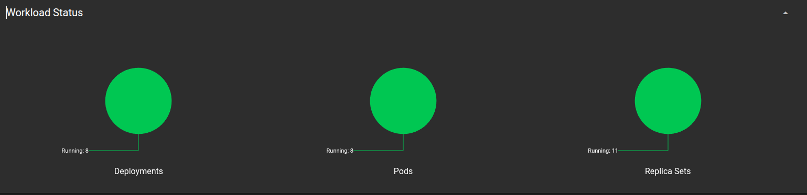

# Go Microservices

A learning-oriented microservices project written in Go. It demonstrates several ways to connect independently running services: JSON over HTTP, Go's `net/rpc`, gRPC with Protocol Buffers, RabbitMQ topic events, and SMTP email. The repository contains five backend microservices, a small browser-based test frontend, and local Docker Compose and Kubernetes deployment examples.

> **Important:** This repository is an educational demonstration, not a production-ready platform. Some connection values and Kubernetes settings in the checked-in deployment files are placeholders or inconsistent with the applications. Review [Known setup caveats](#known-setup-caveats) before trying to start the complete stack.

## Contents

- [At a glance](#at-a-glance)
- [Architecture](#architecture)
- [Services and communication](#services-and-communication)
- [HTTP API](#http-api)
- [Technology and data](#technology-and-data)
- [Run locally](#run-locally)
- [Build commands](#build-commands)
- [Kubernetes manifests](#kubernetes-manifests)
- [Repository layout](#repository-layout)
- [Known setup caveats](#known-setup-caveats)
- [Development notes](#development-notes)

## At a glance

| Component | Responsibility | Main interface |
| --- | --- | --- |
| **Broker service** | HTTP entry point that dispatches a request to authentication, logging, or email | REST/JSON on port `8000` |
| **Authentication service** | Looks up users in PostgreSQL and validates bcrypt password hashes | REST/JSON on port `8000` |
| **Logger service** | Stores log entries in MongoDB and exposes three logging interfaces | REST/JSON `8000`, RPC `5001`, gRPC `50001` |
| **Mail service** | Renders plain-text and HTML email and sends it over SMTP | REST/JSON on port `8000` |
| **Listener service** | Consumes RabbitMQ topic messages and forwards log events to the logger | RabbitMQ consumer |
| **Frontend** | Small page with buttons to exercise the broker's routes | HTTP on port `8099` |
| **Infrastructure** | PostgreSQL, MongoDB, RabbitMQ, and MailHog | Docker Compose or example Kubernetes manifests |

The five services are the broker, authentication, logger, mail, and listener. The frontend is a separate Go web application, not a sixth microservice in the Compose stack.

## Architecture

```text
 Browser
    |
    v
 Frontend (:8099) -- REST/JSON --> Broker (:8000; host port :8090)
                                      |-- REST/JSON --> Authentication (:8000) --> PostgreSQL
                                      |-- REST/JSON --> Mail (:8000) -----------> SMTP
                                      |-- net/rpc ---> Logger (:5001) -----------> MongoDB
                                      `-- gRPC ------> Logger (:50001) ----------> MongoDB

 RabbitMQ topic exchange --> Listener --> REST/JSON --> Logger (:8000) --> MongoDB
```

The broker's host port is `8090` in the supplied Compose file; inside the Compose network the broker listens on `8000`. Likewise, PostgreSQL is published as host port `5433` and listens on container port `5432`.

### A typical request

1. The browser or another client sends a JSON request to the broker.
2. The broker selects a downstream service based on the `action` field.
3. Authentication and email requests use HTTP/JSON. The broker's ordinary log action uses Go RPC; the separate `/log-grpc` route uses gRPC.
4. The logger persists the received entry to MongoDB. Authentication also sends a log to the logger over HTTP.
5. Mail is handed to the configured SMTP server. In local development, that is intended to be MailHog, whose web UI displays captured messages.

RabbitMQ is a separate event-driven path. The listener consumes messages on the `logs_topic` exchange and forwards them to the logger's HTTP endpoint. An event emitter exists in the broker source, but it is not currently selected by any broker HTTP route; see [Known setup caveats](#known-setup-caveats).

## Services and communication

### Broker service

The broker is the public-facing dispatcher. Its HTTP server listens on port `8000` and uses `POST /handle` to accept an action request. The actions currently wired into that handler are:

| `action` | Destination | Protocol |
| --- | --- | --- |
| `auth` | Authentication service, `POST /authenticate` | HTTP + JSON |
| `log` | Logger service, `RPCServer.LogInfo` on port `5001` | Go `net/rpc` |
| `mail` | Mail service, `POST /send` | HTTP + JSON |

`POST /log-grpc` is an additional broker route that sends a log entry to the logger's `WriteLog` gRPC method. `POST /` is a simple broker response route.

### Authentication service

The authentication service listens on port `8000`. `POST /authenticate` accepts an email and plaintext password, loads the user from PostgreSQL, compares the password against its bcrypt hash, and returns an accepted response on success. The user model also contains methods for common database operations, but those methods are not exposed as HTTP routes in the current application.

### Logger service

The logger service listens concurrently on three interfaces:

| Port | Interface | Use |
| --- | --- | --- |
| `8000` | REST/JSON | `POST /log` |
| `5001` | Go `net/rpc` | `RPCServer.LogInfo` |
| `50001` | gRPC | `logs.LogService/WriteLog` |

All three paths create a log entry in the MongoDB database named `logs`, in the `logs` collection. A stored entry includes its name, data, and creation/update timestamps.

### Mail service

The mail service listens on port `8000`, accepts `POST /send`, and uses SMTP to deliver email. It renders both an HTML template and a plain-text alternative. The HTML is processed to inline CSS before sending. For local development, SMTP is intended to point at MailHog on port `1025`.

### Listener service and RabbitMQ

The listener service is a background process: it has no HTTP server. It declares/binds a temporary queue to the `logs_topic` topic exchange for `log.INFO`, `log.WARNING`, and `log.ERROR`, consumes matching messages, and forwards recognized log events to `POST /log` on the logger service.

Queues are created as exclusive, non-durable queues and messages are consumed with automatic acknowledgement. This is suitable for a small demonstration, but does not provide durable event delivery.

### Frontend

The frontend serves a test page at `http://localhost:8099/`. Its buttons issue requests to the broker for the broker response, authentication, RPC logging, gRPC logging, and email. It is built separately and is not included as a service in `project/docker-compose.yml`.

## HTTP API

JSON examples below show the request shapes accepted by the broker. The browser test page includes similar examples in its JavaScript.

### Broker

`POST /handle` — authentication:

```json
{
  "action": "auth",
  "auth": {
    "email": "person@example.com",
    "password": "replace-with-a-test-password"
  }
}
```

`POST /handle` — log via Go RPC:

```json
{
  "action": "log",
  "log": {
    "name": "event",
    "data": "A log message from the broker"
  }
}
```

`POST /log-grpc` — log via gRPC:

```json
{
  "log": {
    "name": "event",
    "data": "A log message sent with gRPC"
  }
}
```

`POST /handle` — email:

```json
{
  "action": "mail",
  "mail": {
    "from": "sender@example.com",
    "to": "recipient@example.com",
    "subject": "Development test",
    "message": "This message should appear in MailHog."
  }
}
```

The broker returns a JSON object with `error`, `message`, and, where applicable, `data` fields. Its normal accepted downstream responses use HTTP `202 Accepted`. Invalid JSON or an unknown action returns an error response.

### Direct service endpoints

| Service | Method and path | Purpose |
| --- | --- | --- |
| Broker | `POST /` | Basic broker response |
| Broker | `POST /handle` | Dispatch `auth`, `log`, or `mail` |
| Broker | `POST /log-grpc` | Send a log entry through gRPC |
| Authentication | `GET /ping` | Health response |
| Authentication | `POST /authenticate` | Validate credentials |
| Logger | `POST /log` | Store a JSON log entry |
| Mail | `GET /ping` | Health response |
| Mail | `POST /send` | Send an email |

Logger RPC and gRPC use their respective ports and are not HTTP endpoints. The Compose file does not publish the logger's ports to the host; call them through the broker or from another container on the Compose network.

## Technology and data

- **Language:** Go. Each backend service has its own Go module; there is no root-level Go module.
- **HTTP:** Chi is used by the broker; Gin is used by authentication, logger, and mail.
- **Synchronous service calls:** REST/JSON, Go `net/rpc`, and gRPC.
- **Asynchronous messaging:** RabbitMQ topic exchange.
- **Relational data:** PostgreSQL database `users` for authentication.
- **Document data:** MongoDB database `logs`, collection `logs`, for log entries.
- **Email:** SMTP, with MailHog provided as a local capture service.
- **Containers:** Individual Dockerfiles and a Docker Compose stack.
- **Kubernetes:** Example Deployments and Services under `project/k8s/`.

### PostgreSQL schema prerequisite

The repository does not include a migration or seed script. The authentication model expects a `users` table with the following columns:

```sql
CREATE TABLE users (
    id          SERIAL PRIMARY KEY,
    email       TEXT NOT NULL UNIQUE,
    first_name  TEXT,
    last_name   TEXT,
    password    TEXT NOT NULL,
    user_active INTEGER NOT NULL DEFAULT 1,
    created_at  TIMESTAMPTZ NOT NULL DEFAULT NOW(),
    updated_at  TIMESTAMPTZ NOT NULL DEFAULT NOW()
);
```

Create the table and add a test account with a valid bcrypt hash before testing successful authentication. No credentials or account seed data should be assumed to exist just because the frontend's sample button uses example values.

## Run locally

### Prerequisites

- Docker Engine and Docker Compose (`docker-compose` for the current Makefile, or an equivalent Compose setup).
- GNU Make.
- A Go toolchain compatible with the individual modules' `go` directives. The backend modules currently request Go versions from `1.24.3` through `1.26.0`; the frontend module declares Go `1.18`.
- PostgreSQL setup described above if you want authentication to succeed.

### Start the backend stack

The Makefile is in `project/`. Its `up_build` target compiles the five backend binaries, stops any existing Compose stack, builds the service images, and starts the containers:

```sh
cd project
make up_build
```

The broker is then intended to be reachable at `http://localhost:8090`. Other published development ports are:

| Host port | Component |
| --- | --- |
| `8090` | Broker HTTP |
| `8091` | Authentication HTTP |
| `5433` | PostgreSQL |
| `27017` | MongoDB |
| `5672` | RabbitMQ AMQP |
| `1025` | MailHog SMTP |
| `8025` | MailHog web interface |

Open `http://localhost:8025` to view captured mail. Start the frontend separately to use the browser test page:

```sh
cd project
make build_front
cd ../front-end/front-end
./frontApp
```

Then open `http://localhost:8099/`. Alternatively, the Makefile provides a `start` target that builds and launches the frontend, and a `stop` target to stop it:

```sh
cd project
make start
# Later:
make stop
```

Try a broker request with curl:

```sh
curl -i http://localhost:8090/handle \
  -H 'Content-Type: application/json' \
  -d '{
    "action": "log",
    "log": {
      "name": "manual-test",
      "data": "Hello from curl"
    }
  }'
```

After confirming the connection settings described below are valid, stop the stack with:

```sh
cd project
make down
```

`make up` only starts existing images; use `make up_build` when you need binaries or images rebuilt.

### Build individual components

From the `project/` directory, the Makefile has targets for each backend binary and the frontend:

```sh
make build_broker
make build_auth
make build_logger
make build_mail
make build_listener
make build_front
```

The backend Dockerfiles copy these prebuilt binaries into their images. Running `docker compose build` alone will not compile the Go programs.

## Kubernetes manifests

Example Kubernetes resources are under `project/k8s/`:

- `broker.yml`
- `authentication.yml`
- `logger.yml`
- `mail.yml`
- `listener.yml`
- `rabbitmq.yml`
- `mongo.yml`
- `mailhog.yml`

They define individual Deployments and Services, but they are not a complete, verified deployment. There is no PostgreSQL manifest, frontend manifest, ingress, persistent-volume configuration, Secret management, or readiness/liveness probe configuration. See [Known setup caveats](#known-setup-caveats) before applying them to a cluster.

### Workload status screenshot

The following screenshot records a Kubernetes dashboard view of the cluster workload at the time it was captured. It shows 8 running Deployments, 8 running Pods, and 11 ReplicaSets; these are point-in-time observations, not a live status report.



## Repository layout

```text
.
├── authentication-service/     # PostgreSQL-backed credential validation
│   ├── cmd/api/                 # HTTP server, routes, and handlers
│   └── data/                    # User model and database operations
├── broker-service/             # HTTP broker and downstream clients
│   ├── cmd/api/                 # HTTP server, dispatch, RPC and gRPC clients
│   ├── event/                  # RabbitMQ publisher/consumer helpers
│   └── logs/                   # Generated Protocol Buffer/gRPC code and .proto
├── front-end/front-end/        # Browser test UI, templates, and Go server
├── listener-service/           # RabbitMQ event consumer
├── logger-service/             # MongoDB logging API, RPC, and gRPC server
│   ├── cmd/api/data/            # MongoDB log-entry model
│   └── logs/                   # Generated Protocol Buffer/gRPC code and .proto
├── mail-service/               # SMTP email API and email templates
├── project/
│   ├── docker-compose.yml       # Local development stack
│   ├── Makefile                # Build, start, and stop commands
│   ├── postgres.yml             # Standalone PostgreSQL Compose definition
│   └── k8s/                    # Kubernetes example manifests
└── README.md
```

The generated gRPC files are checked in alongside the `.proto` definition in both the broker and logger modules. The existing root README previously documented `protoc` generation; if regenerating code, keep the schema and generated code in both modules consistent.